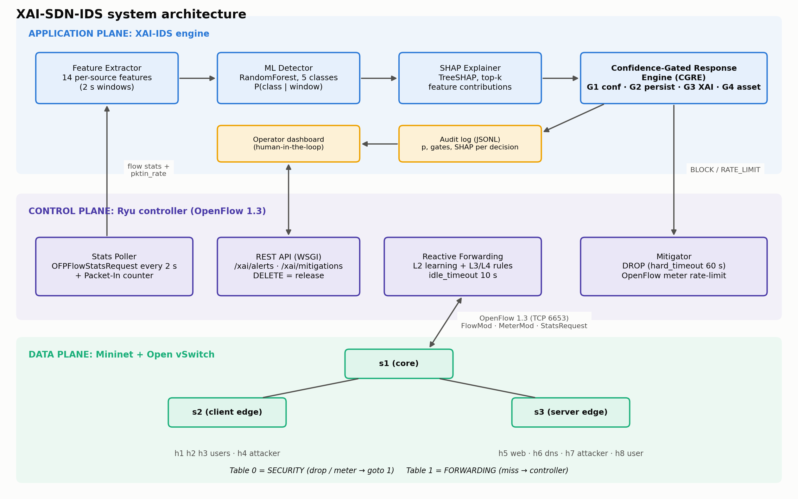
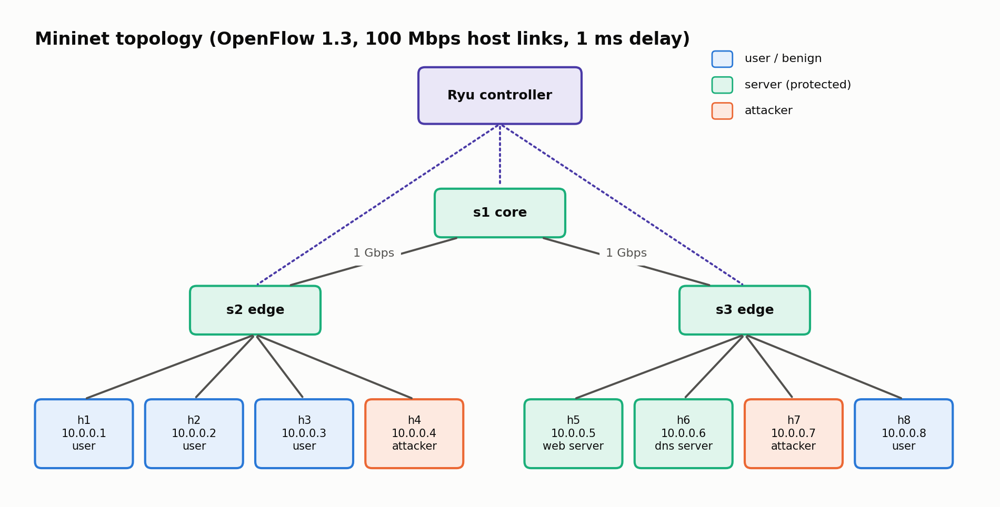
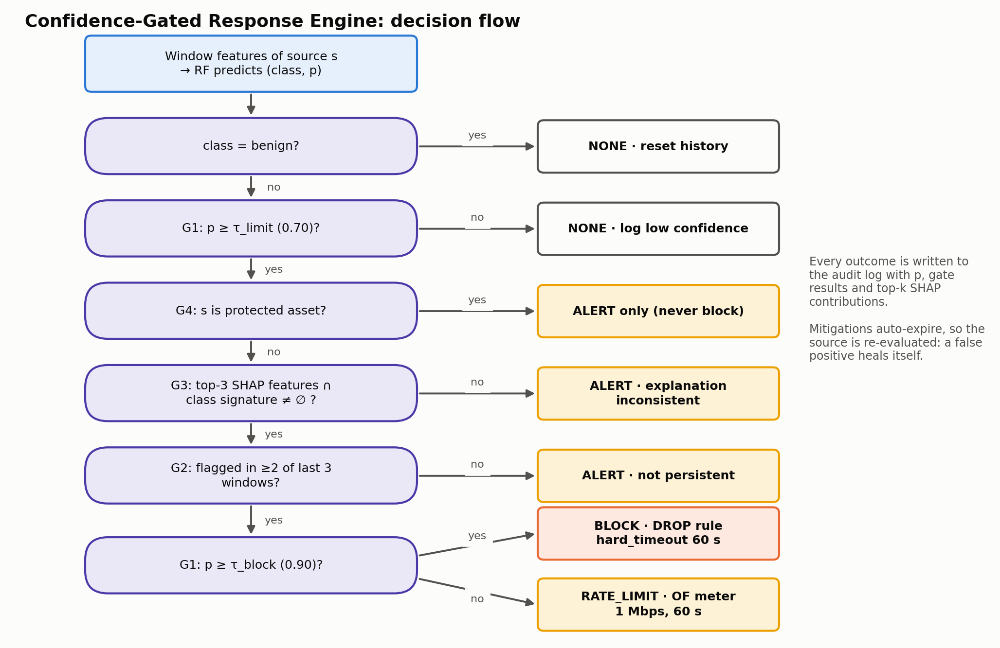
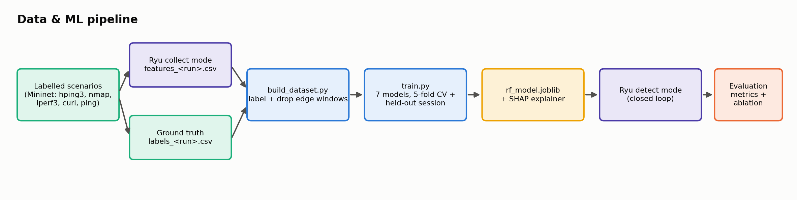
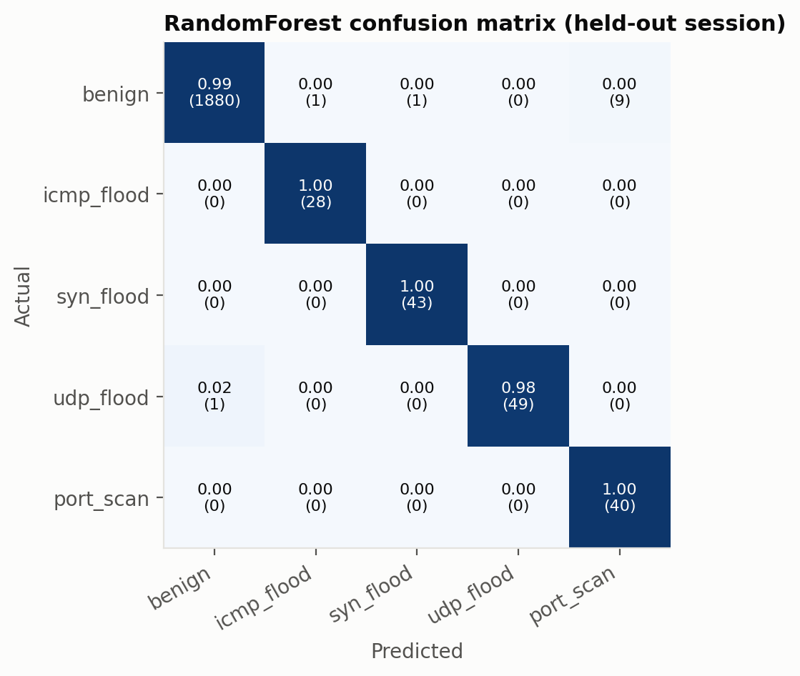
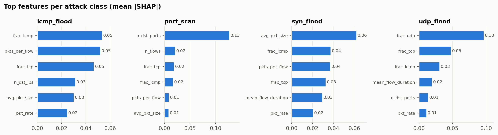

# Abstract

Software-Defined Networking (SDN) centralises control, which makes the controller a natural
place to detect and respond to attacks. Machine-learning intrusion detectors for SDN now
report very high accuracy, but they are black boxes. Most of them also install blocking rules
as soon as the classifier predicts "attack", so one false positive can disconnect a legitimate
host. We present **XAI-SDN-IDS**, a closed-loop system built on Mininet, Open vSwitch and the
Ryu controller (OpenFlow 1.3). It polls OpenFlow flow statistics every 2 s and derives 14
interpretable per-source features. A multi-class Random Forest classifies each window as benign,
ICMP flood, TCP-SYN flood, UDP flood or port scan, and TreeSHAP explains every alert at
feature level. The core contribution is a **Confidence-Gated Response Engine (CGRE)**. It
installs a mitigation only when four conditions hold: classifier confidence, persistence over
time, consistency between the explanation and the attack's expected signature, and
protected-asset safety. Its response is graduated (alert, then OpenFlow-meter rate-limit,
then self-expiring DROP). This report covers Phase 1 (problem and literature review),
Phase 2 (design and architecture) and Phase 3 (implementation and preliminary results).

# 1. Problem Identification (Phase 1)

## 1.1 Background
In SDN the control plane is separated from the data plane. A logically centralised controller
programs switches through OpenFlow, and switches keep per-flow counters (packets, bytes,
duration) that the controller can poll at any time. This global, programmable view lets
security functions (IDS, IPS, firewalls) run as controller applications instead of
separate middleboxes. That is the essence of *Software-Defined Security*. Volumetric
DoS/DDoS floods and reconnaissance scans are still the most common threats against SDN
hosts, and they also stress the control plane itself (Packet-In storms, flow-table growth).

## 1.2 Problem statement
*Collect flow statistics from Mininet/OVS, train an ML-based intrusion detector, provide
feature-level explanations for detected anomalies, and integrate the result with the
controller so that mitigation rules are installed only when defined confidence/security
conditions are satisfied.*

## 1.3 Motivation
1. **Opacity.** Operators cannot see why a source was flagged, so automated blocks are hard
   to trust, audit or debug.
2. **Unsafe automation.** Blocking on the first positive prediction turns every false
   positive into a self-inflicted denial of service. An attacker can even provoke the IDS
   into blocking legitimate hosts.
3. **Offline evaluation.** Many studies score models on CSV datasets only. Their features
   (e.g. CICFlowMeter) are not what a controller can actually measure from OpenFlow counters.

## 1.4 Objectives
| # | Objective |
|---|---|
| O1 | Multi-switch Mininet/OVS testbed with controlled benign traffic and 4 attack classes |
| O2 | Ryu application that polls flow statistics and builds per-source windowed features |
| O3 | Train and compare multi-class ML detectors (Accuracy, Precision, Recall, F1, FPR, FNR) |
| O4 | Feature-level local and global explanations with SHAP |
| O5 | Confidence-Gated Response Engine with graduated, self-expiring OpenFlow mitigation |
| O6 | Evaluate detection/mitigation latency, victim QoS, controller overhead, gating ablation |

## 1.5 Scope and assumptions
In scope: emulated network (Mininet + OVS 2.17, OpenFlow 1.3, Ryu 4.34), and volumetric or
reconnaissance attacks from identifiable source IPs. Out of scope: payload inspection,
encrypted-traffic analysis, IP-spoofed DDoS attribution (future work), and production
hardware.

## 1.6 Expected outcomes
A working closed-loop XAI IDS/IPS, a labelled OpenFlow-statistics dataset, a reproducible
Docker testbed, and an evaluation showing that attacks are mitigated within seconds while
heavy *benign* traffic is not blocked.

# 2. Literature Review (Phase 1)

We reviewed 16 papers published 2020–2026. All were verified against Crossref/arXiv; the full
table, synthesis and verification notes are in `docs/research/literature_review.md`.

| Ref | Work | XAI | Automated mitigation | Gating before mitigation |
|---|---|---|---|---|
| [1] | InSDN dataset (Elsayed et al., 2020) | No | No | No |
| [2] | LSTM + fuzzy anomaly detection & mitigation (Novaes et al., 2020) | No | Yes | Statistical threshold |
| [3] | Two-stage trigger + K-Means/KNN DDoS defence (Tan et al., 2020) | No | Yes | Two-stage pre-filter |
| [4] | DDoS detection in Ryu with feature extraction (Chouhan et al., 2023) | No | No | No |
| [5] | Ensemble online ML, Ryu detection & mitigation (Alashhab et al., 2024) | No | Yes | Not reported |
| [6] | DNN-based rate limiting with trust scores (El Kamel et al., 2022) | No | Yes | Trust score |
| [7] | Explainable ML framework for IDS, SHAP (Wang et al., 2020) | SHAP | No | No |
| [8] | X-IDS survey, human-in-the-loop (Neupane et al., 2022) | Survey | No | Discussed |
| [9] | LIME & SHAP on MLP IDS (Gaspar et al., 2024) | LIME, SHAP | No | No |
| [10] | Explainable DDoS detection on SDN (Raihan & Islam, 2024) | Post-hoc | No | No |
| [11] | OptiXGB-IDS, interpretable multi-class SDN IDS (Saykat et al., 2026) | SHAP, LIME | No | No |
| [12] | XAI-SDN, RF + SHAP for Ryu (Ahmad et al., 2026, preprint) | SHAP | Described, offline | Single τ = 0.70 |
| [13] | Feature-alignment metrics for X-IDS (Alquliti et al., 2025, preprint) | Evaluates XAI | No | No |
| [14] | Human–AI collaboration in SOCs with trusted autonomy (Mohsin et al., 2026) | Yes | Conceptual | Trust thresholds |
| [15] | SLR of ML/DL DDoS detection in SDN (Bahashwan et al., 2023) | n/a | n/a | n/a |
| [16] | DDoS detection & mitigation taxonomy in SDN (Valdovinos et al., 2021) | n/a | Survey | n/a |

## 2.1 Research gaps
- **RG1.** Explanations do not drive SDN mitigation decisions. They stay offline [10], [11]
  or are attached to alerts for human triage [12].
- **RG2.** No multi-condition safety gate before rule installation in SDN. Systems act on a
  label, one threshold, a statistical score or a trust score [2], [3], [5], [6], [12].
  Trust-gated autonomy exists only conceptually for SOCs [8], [14].
- **RG3.** Explanation quality is evaluated offline [9], [13], not used at run time.
- **RG4.** Graduated, self-expiring responses tied to classifier confidence are rare [6].
- **RG5.** SDN XAI studies are mostly binary or offline. Few are multi-class on
  controller-native OpenFlow features [10]–[12].
- **RG6.** Per-flow SHAP is expensive (≈31× throughput drop in [12]).

**Our response:** the CGRE uses SHAP as an *input to the mitigation policy* (RG1, RG3). It
combines confidence, persistence, explanation-consistency and asset gates (RG2). It escalates
from alert to meter to expiring DROP (RG4). The model is multi-class and uses polled OpenFlow
statistics (RG5). SHAP runs only for flagged per-source windows (RG6).

# 3. SDN/SDS Design and Architecture (Phase 2)

## 3.1 Planes and modules
| Plane | Module | Responsibility |
|---|---|---|
| Data | Mininet + OVS (s1 core, s2/s3 edge, 8 hosts) | Forward traffic; keep per-flow counters; enforce DROP/meter rules |
| Control | Ryu: Stats Poller | `OFPFlowStatsRequest` to every switch every 2 s; counts Packet-Ins per source |
| Control | Ryu: Reactive Forwarding | L2 learning; installs L3/L4 rules (`idle_timeout` 10 s) in table 1 |
| Control | Ryu: Mitigator | DROP (`hard_timeout` 60 s) or meter rate-limit in table 0 |
| Control | Ryu: REST API | `/xai/alerts`, `/xai/mitigations`, `DELETE` = operator release |
| Application | Feature Extractor | Per-flow deltas → 14 per-source window features |
| Application | ML Detector | Random Forest, 5 classes, probability per class |
| Application | SHAP Explainer | Top-k feature contributions for flagged windows |
| Application | CGRE | Gates G1–G4 → NONE / ALERT / RATE_LIMIT / BLOCK, audit log |

**Two-table OpenFlow pipeline.** Table 0 is a *security* table: mitigation rules sit there,
and the default rule is `goto table 1`. Table 1 is the *forwarding* table. Security policy
stays separate from forwarding state, and the forwarding counters stay clean for
feature extraction.

**Flow granularity.** Rules match `(ipv4_src, ipv4_dst, ip_proto, service port)`, where the
service port is the lower of the two L4 ports. Random attacker source ports therefore don't
create one rule per packet (flow-table exhaustion), while scans still create one rule per
probed port.

## 3.2 Network topology

## 3.3 Feature set (per source IP, 2-second window)
`pkt_rate, byte_rate, avg_pkt_size, n_flows, new_flows, n_dst_ips, n_dst_ports, frac_tcp,
frac_udp, frac_icmp, pkts_per_flow, frac_small_flows, mean_flow_duration, pktin_rate`.
All features are directly interpretable by a network operator, which is a prerequisite for
meaningful explanations.

## 3.4 Confidence-Gated Response Engine

| Gate | Condition (default) | Purpose |
|---|---|---|
| G1 Confidence | p ≥ 0.70 to act, p ≥ 0.90 to block | No action on uncertain predictions |
| G2 Persistence | flagged in ≥ 2 of the last 3 windows | Ignore transient spikes |
| G3 Explanation consistency | top-3 SHAP features overlap the class signature | Reject predictions driven by irrelevant features |
| G4 Asset safety | source not in protected list (servers) | The IDS cannot be weaponised against core assets |

Mitigations expire automatically (`hard_timeout`), and the source is then re-evaluated, so a
false positive heals itself. An operator can also release a source via REST.

## 3.5 Technology justification
| Choice | Justification |
|---|---|
| Ryu 4.34 | Python-native, so scikit-learn and SHAP run in-process; simple OF1.3 stats, meters and multi-table API. ODL/ONOS are Java-based and heavyweight for ML integration |
| OpenFlow 1.3 | Meters (rate-limiting), multiple tables, per-flow counters |
| Mininet 2.3 + OVS 2.17 | Course-standard emulator with a real OVS kernel datapath |
| Random Forest | Strong on tabular data, inference < 1 ms, exact and fast TreeSHAP |
| SHAP (TreeExplainer) | Additive, consistent attributions; local and global views |
| Docker Compose | Reproducible on every team member's machine. Ryu requires Python 3.9 |

## 3.6 Data and ML pipeline

# 4. Implementation (Phase 3)

## 4.1 Development environment
| Item | Value |
|---|---|
| Host | Ubuntu 24.04, kernel 7.0, 22 vCPU, 16 GB RAM |
| Controller container | Python 3.9, Ryu 4.34, scikit-learn 1.5.2, SHAP 0.46, pandas 2.2 |
| Data-plane container | Ubuntu 22.04, Mininet 2.3, Open vSwitch 2.17, hping3, nmap, iperf3 (privileged) |
| Orchestration | Docker Compose. Controller ↔ switches over OpenFlow TCP 6653 on a bridge network |

## 4.2 Source code structure
| File | Purpose |
|---|---|
| `topology/topo.py` | 3-switch / 8-host topology, remote Ryu controller, OF1.3 |
| `controller/xai_ids_app.py` | Ryu app: two-table pipeline, forwarding, stats poller, mitigator, REST API |
| `ids/features.py` | Flow-stats deltas → per-source window features |
| `ids/detector.py`, `ids/explainer.py` | Model inference; TreeSHAP top-k explanations |
| `ids/policy.py` | Confidence-Gated Response Engine (gates, graduated response, expiry) |
| `ids/config.py` | Thresholds, class signatures, protected assets |
| `traffic/scenarios.py` | Labelled benign/attack episode generator with ground-truth timestamps |
| `ml/build_dataset.py`, `ml/train.py` | Labelling, model comparison, SHAP figures, model export |

## 4.3 Traffic scenarios
| Class | Generator (randomised parameters) | Sources |
|---|---|---|
| Background benign | HTTP (curl loops), ping, 1 Mbps UDP stream, low-rate DNS-like UDP | h1, h2, h3, h8 |
| Heavy benign | iperf3 TCP (20 Mbps to unlimited) or UDP 5–10 Mbps | users |
| ICMP flood | `hping3 -1 -i u{400–4000} -d {0–500}` | h4, h7 (sometimes h3) |
| SYN flood | `hping3 -S -p {80,22,443} -i u{400–4000}` | h4, h7 |
| UDP flood | `hping3 --udp -p {53,123,5060} -i u{…} -d {0–512}` | h4, h7 |
| Port scan | `nmap -sS/-sT -T3/-T4/-T5 -p 1-3000` (looped) | h4, h7 |

Independent sessions with different random seeds were recorded. One is used for
training (with 5-fold CV), the other as a **held-out test session**, so reported metrics
reflect generalisation to unseen traffic rather than memorised windows.

## 4.4 Preliminary results

**Dataset.** Training session *train1*: 20 episodes, 2,765 labelled windows (2,505 benign,
55–75 per attack class). Held-out session *test2*: 15 episodes with a different seed, 2,052
windows (1,891 benign, 28–50 per attack class). Windows straddling episode boundaries are
dropped as ambiguous.

**Model comparison** (trained on *train1*, tested on *test2*; macro-averaged over 5 classes;
FPR/FNR use the benign-vs-attack view):

| Model | CV F1 (train) | Accuracy | Precision | Recall | **F1** | FPR | FNR | Inference µs/sample* |
|---|---|---|---|---|---|---|---|---|
| **Random Forest** | 0.988 | **0.994** | **0.952** | **0.995** | **0.971** | **0.006** | 0.006 | 37 |
| Extra Trees | 0.993 | 0.989 | 0.914 | 0.994 | 0.950 | 0.011 | 0.006 | 35 |
| Hist. Gradient Boosting | 0.993 | 0.984 | 0.868 | 0.993 | 0.922 | 0.016 | 0.006 | 34 |
| Decision Tree | 0.980 | 0.962 | 0.833 | 0.988 | 0.881 | 0.041 | 0.000 | 0.6 |
| KNN | 0.970 | 0.925 | 0.735 | 0.865 | 0.756 | 0.070 | 0.106 | 90 |
| MLP | 0.983 | 0.882 | 0.662 | 0.922 | 0.701 | 0.123 | 0.068 | 8 |
| Logistic Regression | 0.979 | 0.822 | 0.640 | 0.957 | 0.682 | 0.193 | 0.000 | 1.3 |

\* batch inference on the test set. Live single-window inference in the controller
(including Python/eventlet overhead) measured 9–31 ms.

Cross-validation scores are close for all models (0.97–0.99), but on an *independent
session* the gap widens sharply (F1 0.68–0.97). Evaluating on a separate recording is
therefore essential, and same-session CV overstates performance. Random Forest generalises
best and is deployed.

Per class (RF): ICMP flood F1 0.98, SYN flood 0.99, UDP flood 0.99, port scan 0.90 (recall
1.00, precision 0.82). The port-scan false positives are windows of the *attacker* host
logged just after its episode ended: OpenFlow statistics lag by up to two polling
intervals. They are not innocent hosts.

**Explanations.** The global and per-class SHAP rankings match domain knowledge. Port scans
are driven by `n_dst_ports` and `n_flows`, UDP floods by `frac_udp`, ICMP floods by
`frac_icmp` and `pkts_per_flow`, and SYN floods by `avg_pkt_size` (54-byte SYNs) and
`frac_tcp`. This supports the class signatures used by gate G3.

**Gating ablation** (replay of the held-out session through the model, SHAP and the response
engine; `ml/replay_ablation.py`):

| Policy | Innocent hosts impaired | Benign-labelled time under mitigation | Attacks mitigated | Mean time to mitigate |
|---|---|---|---|---|
| Naive: block on any attack label | **2** (h6 DNS server, h8 user) | 72 s | 12/12 | 5.1 s |
| G1 confidence | 0 | 10 s† | 12/12 | 5.1 s |
| G1 + G2 persistence | 0 | 10 s† | 12/12 | 5.9 s |
| Full CGRE (G1–G4) | **0** | 10 s† | 12/12 | 5.9 s |

† attacker h4 between two of its own episodes (statistics lag), not an innocent host.

The naive policy blocked a protected server and a user. Both were *victims* whose
reply traffic to a flood resembled the flood. Gating removed all innocent-host impairment
without missing any attack, at a cost of about 0.8 s extra time-to-mitigate. In this
session, confidence gating (G1) alone was enough to remove these false positives. G2–G4 did
not change outcomes here; they are defence-in-depth against noisy or adversarial inputs and
will be evaluated with targeted scenarios in Phase 5.

**Live closed-loop demonstration** (`scripts/demo.sh`, detect mode; a 10 Mbps benign UDP
transfer, then three attacks):

| Episode | First flagged | Mitigated | Action | Explanation recorded in audit log |
|---|---|---|---|---|
| Heavy benign (h1, 10 Mbps UDP) | never | never | none | |
| SYN flood (h4 → h5) | 2.2 s | 6.4 s | ALERT → BLOCK | frac_tcp=1.0, avg_pkt_size=54 B, frac_icmp=0 |
| Port scan (h7 → h6) | 3.8 s | 6.1 s | ALERT → BLOCK | n_dst_ports=538, n_flows=538, pkts_per_flow=0.1 |
| UDP flood (h4 → h8) | 2.3 s | 2.4 s | RATE_LIMIT (p=0.89) → BLOCK (p=0.97) | frac_udp=1.0, frac_tcp=0 |

Per-alert SHAP explanation cost was about 2.5 ms, so explaining only flagged windows makes
the explanation overhead negligible (cf. RG6).

**Observed limitation (input to Phase 4).** An ICMP flood at about 2,400 pps was classified
correctly but with confidence below 0.70. In training, the victims' echo-*reply* streams at
the same rate are labelled benign, and per-source counters cannot tell request from reply.
Planned fixes: an ICMP-type feature (flow match on `icmpv4_type`) and a reflection-aware gate
G5 that suppresses mitigation of a host whose traffic answers a source currently flagged as
attacking it.

**Unit tests.** 9 tests cover feature extraction (counter deltas, ingress-switch
selection, scan shape) and every CGRE gate and response level; all pass.

# 5. Plan for Phases 4–7 (16–19 November)

| Period | Work |
|---|---|
| 16–22 Oct | More sessions and attack intensities (incl. low-rate), hyper-parameter tuning, InSDN cross-check |
| 23–29 Oct | Closed-loop CGRE hardening, meter-based rate limiting, audit log, REST API |
| 30 Oct–5 Nov | Experiments: detection/mitigation latency, victim throughput/RTT/loss, CPU/memory, ablation naive vs. gated, SHAP vs. LIME |
| 6–12 Nov | Operator dashboard, final report and figures |
| 13–15 Nov | Demo rehearsal, viva preparation |

# References

[1] M. S. Elsayed, N.-A. Le-Khac, and A. D. Jurcut, "InSDN: A novel SDN intrusion dataset," *IEEE Access*, vol. 8, pp. 165263–165284, 2020, doi: 10.1109/ACCESS.2020.3022633.

[2] M. P. Novaes, L. F. Carvalho, J. Lloret, and M. L. Proença Jr., "Long short-term memory and fuzzy logic for anomaly detection and mitigation in software-defined network environment," *IEEE Access*, vol. 8, pp. 83765–83781, 2020, doi: 10.1109/ACCESS.2020.2992044.

[3] L. Tan, Y. Pan, J. Wu, J. Zhou, H. Jiang, and Y. Deng, "A new framework for DDoS attack detection and defense in SDN environment," *IEEE Access*, vol. 8, pp. 161908–161919, 2020, doi: 10.1109/ACCESS.2020.3021435.

[4] R. K. Chouhan, M. Atulkar, and N. K. Nagwani, "A framework to detect DDoS attack in Ryu controller based software defined networks using feature extraction and classification," *Applied Intelligence*, vol. 53, no. 4, pp. 4268–4288, 2023, doi: 10.1007/s10489-022-03565-6.

[5] A. A. Alashhab et al., "Enhancing DDoS attack detection and mitigation in SDN using an ensemble online machine learning model," *IEEE Access*, vol. 12, pp. 51630–51649, 2024, doi: 10.1109/ACCESS.2024.3384398.

[6] A. El Kamel, H. Eltaief, and H. Youssef, "On-the-fly (D)DoS attack mitigation in SDN using deep neural network-based rate limiting," *Computer Communications*, vol. 182, pp. 153–169, 2022, doi: 10.1016/j.comcom.2021.11.003.

[7] M. Wang, K. Zheng, Y. Yang, and X. Wang, "An explainable machine learning framework for intrusion detection systems," *IEEE Access*, vol. 8, pp. 73127–73141, 2020, doi: 10.1109/ACCESS.2020.2988359.

[8] S. Neupane et al., "Explainable intrusion detection systems (X-IDS): A survey of current methods, challenges, and opportunities," *IEEE Access*, vol. 10, pp. 112392–112415, 2022, doi: 10.1109/ACCESS.2022.3216617.

[9] D. Gaspar, P. Silva, and C. Silva, "Explainable AI for intrusion detection systems: LIME and SHAP applicability on multi-layer perceptron," *IEEE Access*, vol. 12, pp. 30164–30175, 2024, doi: 10.1109/ACCESS.2024.3368377.

[10] Z. Raihan and S. Islam, "Enhancing transparency in DDoS detection on SDN using explainable ML models," in *Proc. 2nd Int. Conf. Information and Communication Technology (ICICT)*, 2024, pp. 76–80, doi: 10.1109/ICICT64387.2024.10839660.

[11] M. T. H. Saykat et al., "An efficient and interpretable intrusion detection framework for software-defined networks with multi-class imbalanced data using genetic and GAN-based optimization," *Scientific Reports*, vol. 16, Art. no. 21406, 2026, doi: 10.1038/s41598-026-58514-x.

[12] A. Ahmad, A. Akarma, A. Ali, H. Muneer, and T. A. Syed, "XAI-SDN: An explainable entropy-guided machine learning framework for real-time DDoS detection in software defined networks," arXiv:2609.05701 (preprint), 2026.

[13] M. Alquliti, E. Karafili, and B. Kang, "Evaluating explanation quality in X-IDS using feature alignment metrics," arXiv:2505.08006 (preprint), 2025.

[14] A. Mohsin, H. Janicke, A. Ibrahim, I. H. Sarker, and S. Camtepe, "A unified framework for human–AI collaboration in security operations centers with trusted autonomy," *ACM Trans. Internet Technology*, vol. 26, no. 4, pp. 1–34, 2026, doi: 10.1145/3837073.

[15] A. A. Bahashwan et al., "A systematic literature review on machine learning and deep learning approaches for detecting DDoS attacks in software-defined networking," *Sensors*, vol. 23, no. 9, Art. no. 4441, 2023, doi: 10.3390/s23094441.

[16] I. A. Valdovinos, J. A. Pérez-Díaz, K.-K. R. Choo, and J. F. Botero, "Emerging DDoS attack detection and mitigation strategies in software-defined networks: Taxonomy, challenges and future directions," *J. Network and Computer Applications*, vol. 187, Art. no. 103093, 2021, doi: 10.1016/j.jnca.2021.103093.
